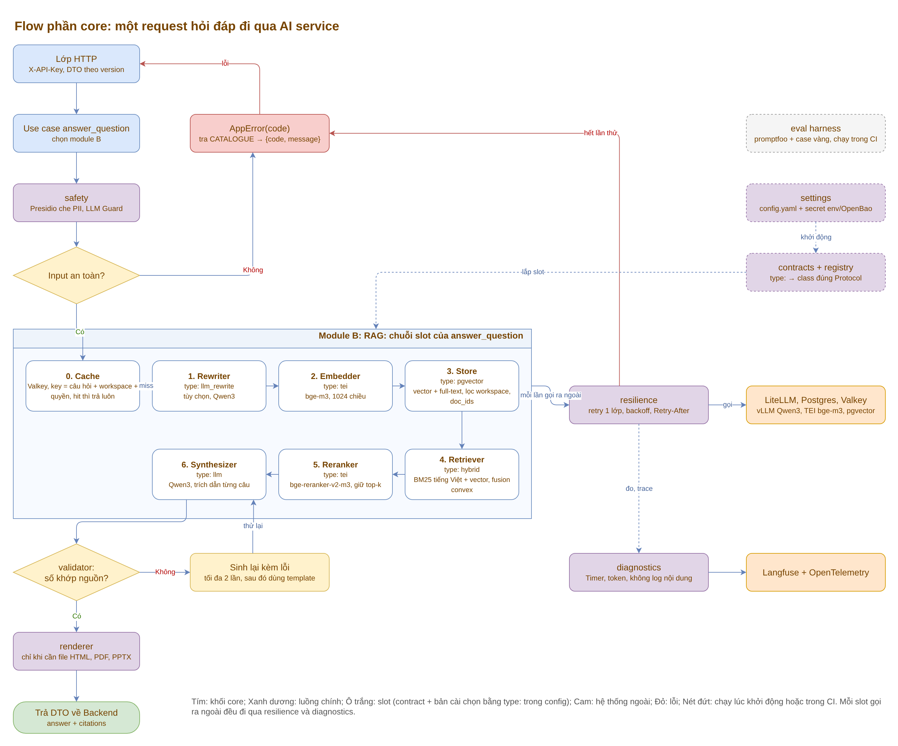
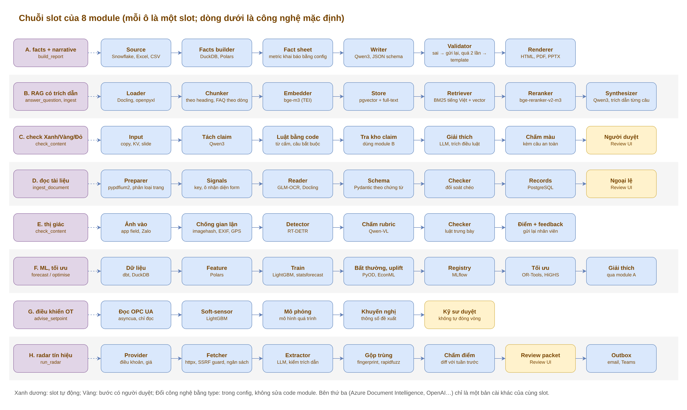
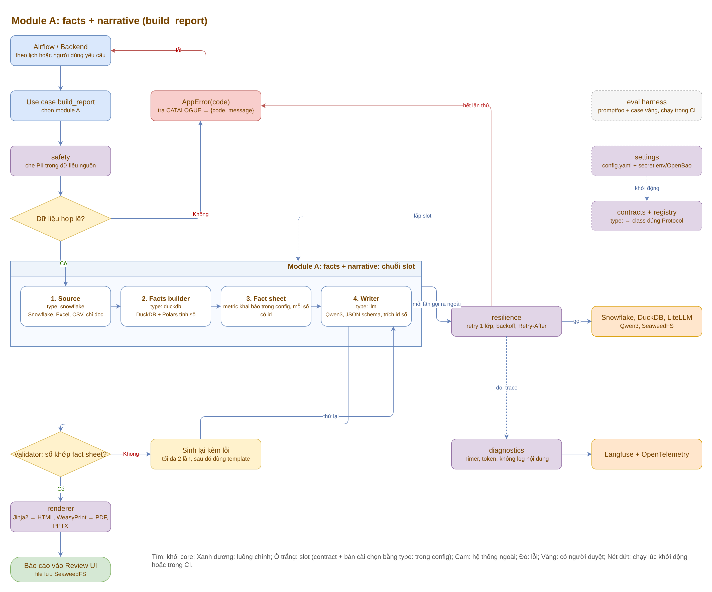
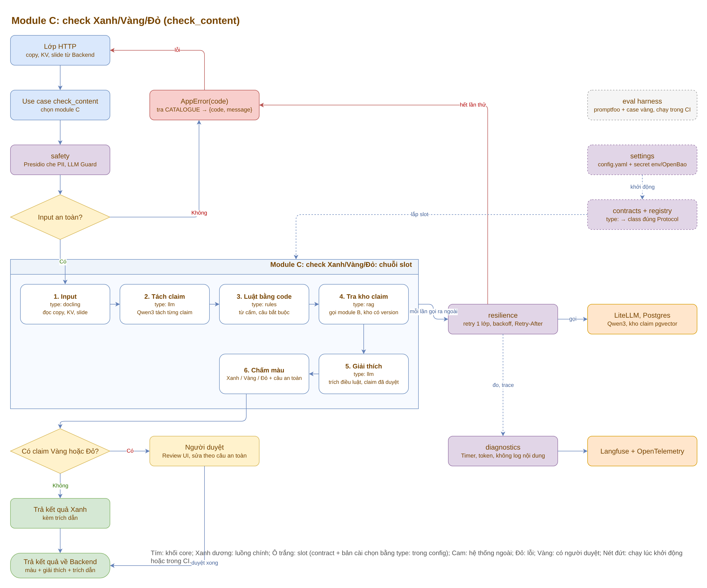
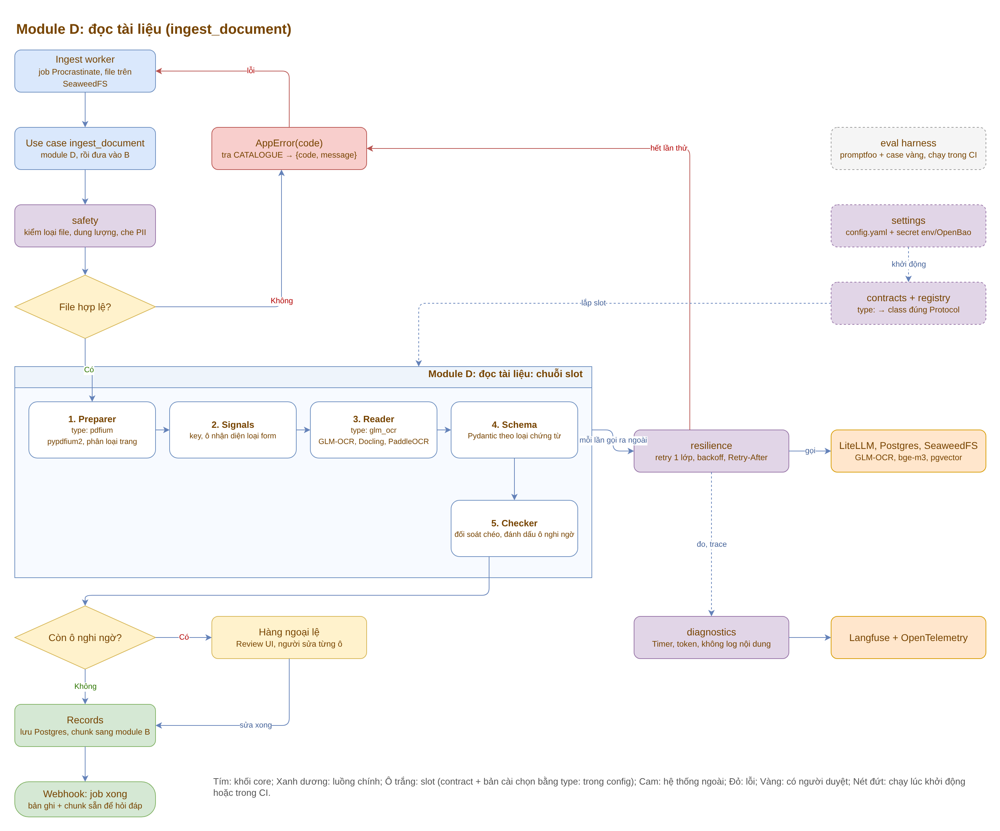
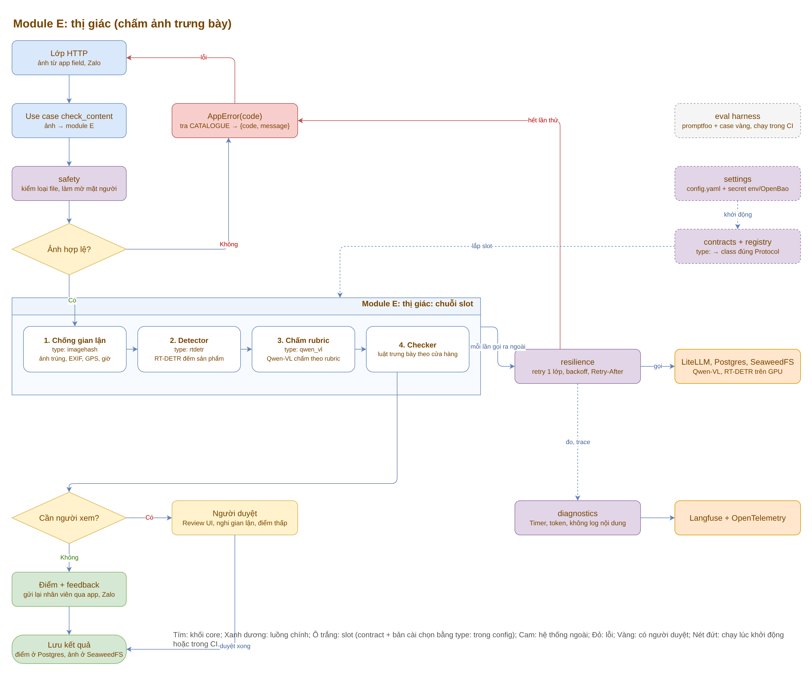
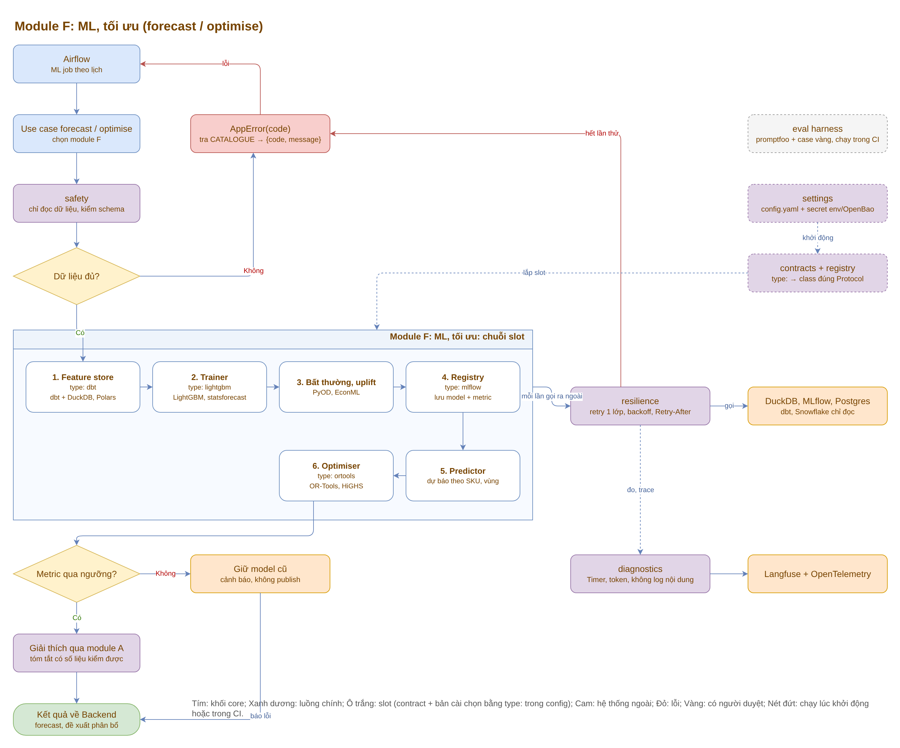
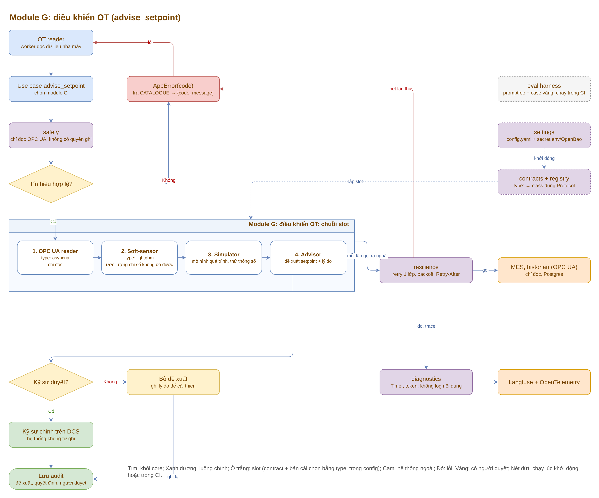
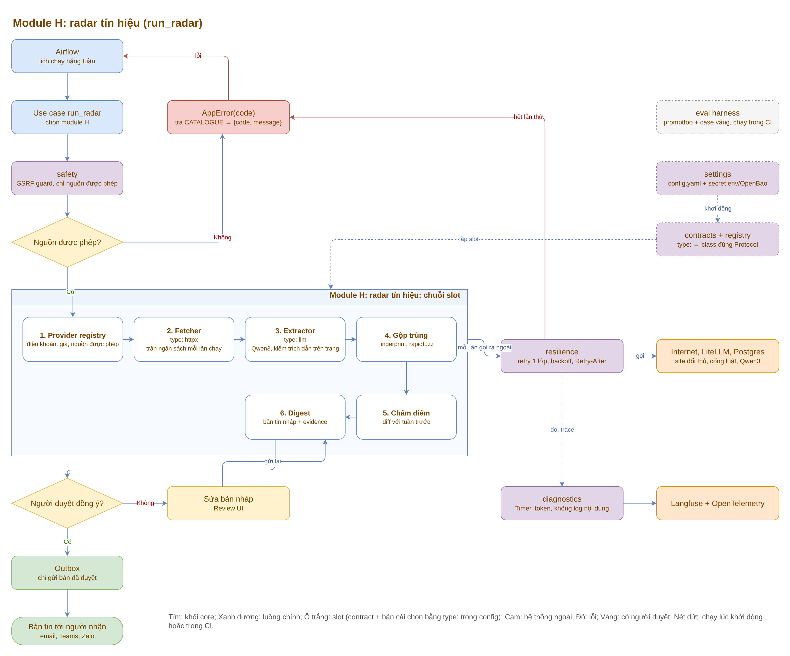

# BeyondPilot: luồng, phần core và kế hoạch chuyển từ pilot

Tài liệu này ghi lại cách repo pilot (`sre-copilot/`) được dùng lại cho BeyondPilot, nền tảng AI cho Nestlé Việt Nam.

Kiến trúc BeyondPilot lấy từ sơ đồ `he-sinh-thai-ai.drawio` (3 trang) trong dự án `market-report`. Phần core ở đây vẽ theo **thiết kế**, chưa đối chiếu với code core thật.

## File trong thư mục

| File | Nội dung | Mở bằng |
|---|---|---|
| [core-flow.drawio](core-flow.drawio) | 9 trang: flow core (module B), chuỗi slot 8 module, và 7 trang chi tiết module A, C, D, E, F, G, H | draw.io hoặc app.diagrams.net |
| [images/](images/) | Ảnh xuất từ 9 trang trên, nhúng vào README này | Bất kỳ trình xem ảnh |
| [scripts/](scripts/) | Script sinh file `.drawio` và xuất ảnh PNG | Python, Node |
| [beyondpilot-flows.html](beyondpilot-flows.html) | Bảng map pilot → BeyondPilot và các luồng (sơ đồ Mermaid) | Trình duyệt |

## Flow phần core



Ảnh xuất từ trang 1 của [core-flow.drawio](core-flow.drawio). Cách xuất lại ở mục [Cập nhật sơ đồ](#cập-nhật-sơ-đồ).

### Đường đi của một request

1. **Lớp HTTP** nhận request từ Backend nghiệp vụ, kiểm `X-API-Key` (so khớp hằng thời gian) và chuyển DTO theo version.
2. **Use case** (`answer_question`, `ingest_document`, `build_report`, `check_content`, `run_radar`, `forecast / optimise`, `advise_setpoint`) chọn module cần chạy.
3. **safety**: Presidio che PII, LLM Guard kiểm prompt injection.
   - Không an toàn thì trả `AppError(code)` về lớp HTTP.
4. **Module** chạy lần lượt từng slot. Với `answer_question` (module B):

   | # | Slot | Bản cài mặc định (`type:`) | Gọi ra ngoài |
   |---|---|---|---|
   | 0 | Cache | Valkey, key = câu hỏi + workspace + quyền. Hit thì trả luôn | Valkey |
   | 1 | Rewriter | `llm_rewrite`, tùy chọn, viết lại câu hỏi cho dễ tìm | Qwen3 qua LiteLLM |
   | 2 | Embedder | `tei`, bge-m3, 1024 chiều | TEI qua LiteLLM |
   | 3 | Store | `pgvector`, vector + full-text, lọc theo `workspace_id` và `doc_ids` | Postgres |
   | 4 | Retriever | `hybrid`, gộp BM25 tiếng Việt + vector bằng fusion convex | — |
   | 5 | Reranker | `tei`, bge-reranker-v2-m3, giữ top-k | TEI qua LiteLLM |
   | 6 | Synthesizer | `llm`, Qwen3, câu nào cũng có trích dẫn | Qwen3 qua LiteLLM |

   - Mỗi lần gọi ra ngoài (LiteLLM, Postgres, S3) đi qua **resilience**: retry đúng 1 lớp, backoff, theo `Retry-After`.
   - Hết số lần thử thì trả `AppError(code)`.
   - **diagnostics** đo thời gian, đếm token, gửi trace sang Langfuse và OpenTelemetry. Không log nội dung câu hỏi hay câu trả lời.
5. **validator**: con số nào trong câu trả lời cũng phải tính lại được từ facts (evidence DSL).
   - Sai thì gửi lại LLM kèm lỗi, tối đa 2 lần, sau đó dùng template cố định.
6. **renderer** xuất HTML, PDF hoặc PPTX nếu use case cần.
7. Trả DTO về Backend.

### Chuỗi slot của 8 module



Mỗi module là một chuỗi slot cố định; mỗi slot có contract riêng và chọn bản cài bằng `type:` trong config. Ô vàng là bước có người duyệt qua Review UI. Đổi công nghệ (ví dụ thay GLM-OCR bằng Azure Document Intelligence) là đổi `type:` của slot đó, không sửa code module.

### Chi tiết từng module

Mỗi module vẽ theo cùng khuôn với module B ở trên: điểm vào → use case → safety → chuỗi slot → bước kiểm tra cuối → kết quả. Cột phải (resilience, diagnostics, settings, registry) giống nhau ở mọi module.

#### Module A: facts + narrative (`build_report`)



Airflow hoặc Backend gọi. Source đọc Snowflake/Excel chỉ đọc → DuckDB tính facts → fact sheet (mỗi số có id) → Qwen3 viết bài. Validator kiểm số khớp fact sheet; sai thì Writer viết lại, tối đa 2 lần rồi dùng template. Renderer xuất HTML/PDF/PPTX vào Review UI.

#### Module C: check Xanh/Vàng/Đỏ (`check_content`)



Đọc copy, KV, slide → tách claim → kiểm luật bằng code → tra kho claim qua module B → giải thích có trích điều luật → chấm màu. Có claim Vàng/Đỏ thì chuyển người duyệt trên Review UI.

#### Module D: đọc tài liệu (`ingest_document`)



Ingest worker lấy job từ Procrastinate. Preparer → Signals → Reader (GLM-OCR, Docling) → Schema → Checker. Còn ô nghi ngờ thì vào hàng ngoại lệ cho người sửa; xong thì lưu Records và chunk sang module B, rồi webhook báo Backend.

#### Module E: thị giác (`check_content (ảnh)`)



Ảnh từ app field, Zalo → chống gian lận (ảnh trùng, EXIF, GPS) → RT-DETR đếm sản phẩm → Qwen-VL chấm rubric → luật trưng bày. Nghi gian lận hoặc điểm thấp thì chuyển người duyệt; còn lại gửi điểm và feedback cho nhân viên.

#### Module F: ML, tối ưu (`forecast / optimise`)



Airflow chạy ML job: dbt/DuckDB → feature → LightGBM → phát hiện bất thường → lưu MLflow → dự báo → OR-Tools tối ưu. Metric không qua ngưỡng thì giữ model cũ; qua thì đưa kết quả cho module A viết tóm tắt.

#### Module G: điều khiển OT (`advise_setpoint`)



OT reader đọc OPC UA (chỉ đọc) → soft-sensor → mô phỏng → đề xuất setpoint. Kỹ sư duyệt rồi tự chỉnh trên DCS; hệ thống không bao giờ tự ghi. Mọi quyết định được lưu audit.

#### Module H: radar tín hiệu (`run_radar`)



Airflow chạy hằng tuần: provider registry → fetcher (SSRF guard, trần ngân sách) → Qwen3 trích xuất có kiểm trích dẫn → gộp trùng → chấm điểm so với tuần trước → bản tin nháp. Người duyệt đồng ý thì vào Outbox; không thì sửa bản nháp.

### Ngoài đường request

- **settings + contracts/registry** chạy lúc khởi động: đọc `config.yaml` và secret (env hoặc OpenBao), tìm class theo `type:` của từng slot, kiểm class có đúng Protocol không rồi lắp vào module. Sai cấu hình thì dừng khởi động.
- **eval harness** (promptfoo + bộ case vàng) chạy trong CI. Điểm tụt thì chặn merge.

### 10 khối core

| Khối | Vai trò | Lấy từ pilot |
|---|---|---|
| contracts (`base/`) | Protocol: Source, Reader, Writer, Store, Retriever, Checker, Llm | — |
| registry, slot | `type:` trong config → class; tên type = tên file | — |
| settings | `config.yaml.template` → `config.yaml`; secret lấy từ env | `config.py` |
| errors | `ErrorCode` + `CATALOGUE`; chỉ raise `AppError(code)` | — |
| resilience | retry 1 lớp, backoff, theo `Retry-After` | — |
| diagnostics | Timer, log_scope, đếm token, không log nội dung | `observability/`, `utils/logger.py` |
| validator + evidence DSL | số trong câu phải tính lại được từ facts | — |
| renderer | Jinja2 → HTML, WeasyPrint → PDF, python-pptx → PPTX | — |
| safety | Presidio (PII), LLM Guard (prompt injection) | `guardrails/` (giữ interface `GuardrailResult`) |
| eval harness | promptfoo + bộ case vàng, chạy trong CI | — |

Quy tắc: core không import web framework; module chỉ nói chuyện với core qua contract.

## Map pilot → BeyondPilot (tóm tắt)

Chi tiết đủ 27 dòng ở [beyondpilot-flows.html](beyondpilot-flows.html).

| Pilot | BeyondPilot | Việc |
|---|---|---|
| FastAPI, `/v1/search`, `/v1/answer` | AI service, `/api/v1`, use case `answer_question` | giữ |
| `middleware/auth.py` | Auth `X-API-Key` giữa Backend ↔ AI service | giữ, sửa so khớp |
| `services/redis_cache.py` | Valkey cache, key gồm workspace + quyền | giữ, sửa key |
| Milvus | PostgreSQL + pgvector + full-text | thay |
| Embedding OpenAI/Ollama/hash (1536 chiều) | bge-m3 qua TEI (1024 chiều) | thay |
| `LLMRouter` OpenAI → Ollama | Slot `Llm` → LiteLLM → vLLM Qwen3, bên thứ ba chỉ dự phòng | thay |
| `guardrails/` heuristic + NeMo | Presidio + LLM Guard | thay |
| `ingestion/pipeline.py` | Ingest worker module D → B, hàng đợi Procrastinate | thay |
| Nguồn Loki/Prom/Tempo, Attu | — | bỏ |
| — | Keycloak + Entra ID, Backend nghiệp vụ, Review UI, Outbox, module A, C, D, E, F, G, H | viết mới |

## Kế hoạch task

Thứ tự đã chốt: phần AI trước, sau đó FE + BE, cuối cùng là hạ tầng. ⚠️ là task liên quan đến lộ dữ liệu giữa người dùng, nên làm sớm.

### A. Phần AI

**A1. Lõi AI service**
1. Khung AI service: router `/api/v1`, `/internal/v1` (health, ready), DTO theo version
2. Auth `X-API-Key` giữa Backend ↔ AI service
3. `core/settings` + khoá `type:` cho từng slot
4. `core/errors`
5. `core/contracts` + registry slot
6. `core/resilience`
7. `core/diagnostics`

**A2. Model và safety**

8. Slot `Llm` gọi qua LiteLLM
9. Cấu hình LiteLLM: vLLM, TEI, bên thứ ba dự phòng, ngân sách
10. `core/safety`: Presidio + LLM Guard
11. `core/validator` + evidence DSL

**A3. Module B: RAG**

12. Tách `RetrievalService` thành các slot
13. ⚠️ Store pgvector có lọc theo quyền và workspace
14. Embedder bge-m3
15. Retriever lai BM25 tiếng Việt + vector
16. Reranker bge-reranker-v2-m3
17. Synthesizer có trích dẫn từng câu
18. ⚠️ Cache Valkey, key gồm workspace và quyền
19. Viết lại câu hỏi

**A4. Module D: nạp tài liệu**

20. Hàng đợi Procrastinate, job nạp idempotent theo file
21. Loader Docling, chunker cắt theo heading
22. Module D: OCR, đọc form, checker
23. Hook báo tiến độ về Backend
24. Bỏ nguồn Loki/Prom/Tempo và Attu

**A5. Eval và quan sát**

25. promptfoo + bộ case vàng trong CI
26. Trace OpenTelemetry + Langfuse

**A6. Các module AI còn lại**

27. Module A: facts + narrative + renderer
28. Module C: check Xanh/Vàng/Đỏ
29. Module H: radar tín hiệu
30. Module E: chấm ảnh
31. Module F: ML, tối ưu
32. Module G: điều khiển OT

### B. Frontend và Backend

33. Traefik + Keycloak + Entra ID (SSO)
34. Backend nghiệp vụ: quyền, workspace, audit
35. Rate limit bằng Valkey
36. Review UI
37. Outbox + channel adapters (Teams, Zalo, email)

### C. Hạ tầng

38. Chốt nơi lưu trace và log (Tempo/Loki hay chỗ khác)
39. Helm chart cho k3s, giữ docker compose cho dev

## Cập nhật sơ đồ

File `core-flow.drawio` được sinh từ `scripts/gen_core_flow.py`. Sửa script rồi chạy lại 2 bước:

```bash
python3 docs/beyondpilot/scripts/gen_core_flow.py docs/beyondpilot/core-flow.drawio
```

```bash
cd docs/beyondpilot/scripts && npm install --no-save mxgraph@4.2.2 playwright && node render_drawio.js ../core-flow.drawio ../images/core-flow.png 0 && node render_drawio.js ../core-flow.drawio ../images/module-slots.png 1 && i=2; for m in a c d e f g h; do node render_drawio.js ../core-flow.drawio ../images/module-$m.png $i; i=$((i+1)); done
```

Tham số cuối là số trang (0 là trang 1). Sửa tay trong draw.io cũng được, nhưng lần chạy script sau sẽ ghi đè.

## Việc còn mở

- **Contract quyền giữa Backend và AI service:** đề xuất Backend gửi `workspace_id` và danh sách `doc_ids` được xem trong mỗi request, để làm task 13 mà không phải chờ task 34.
- **Đối chiếu với code core thật:** code core nằm trong các file zip trên Drive, chưa đọc được. Đọc xong cần sửa lại flow core và bảng 10 khối nếu lệch.
- **Nơi lưu trace và log:** sơ đồ BeyondPilot không có Tempo và Loki, trong khi pilot đang dùng.

---

*Cập nhật: 02/11/2026*
